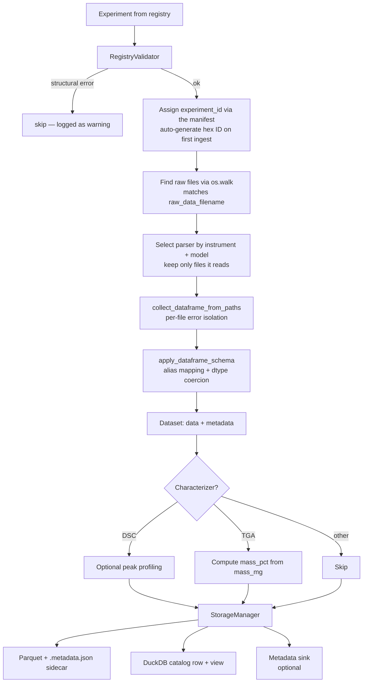
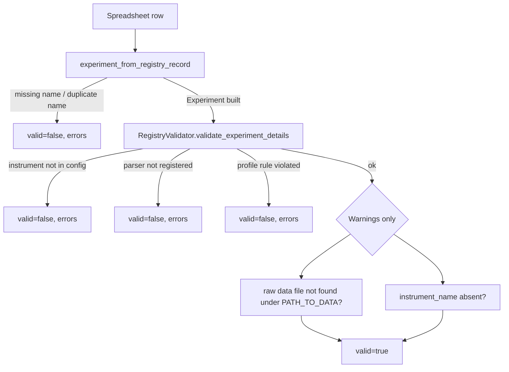
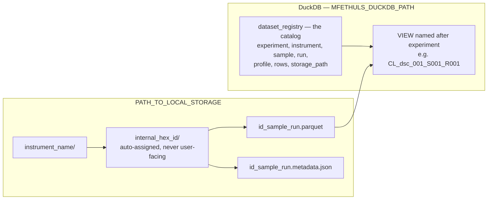

# mfethuls architecture

mfethuls bridges laboratory instrument exports and analysis-ready datasets: a **registry** (spreadsheet) describes experiments; an **ETL pipeline** parses and normalizes raw data; **storage and a query catalog** expose Parquet files and SQL to notebooks and the app.

---

## ETL core — single experiment



| Step | Module |
|------|--------|
| Registry load | `experiments.py` — `Registry.load` / `Registry.from_frame`, `experiment_from_registry_record` |
| Validation | `registry_validator.py` — `validate_registry_dataframe`, `RegistryValidator` |
| ID assignment | `manifest.py` — `FileManifestBackend` (any `ManifestBackend`) |
| Path resolution | `manifest.py` — `find_data_files()` walks the instrument folder by `raw_data_filename` |
| Which files are data | `parsers/registry.py` — `data_extensions(parser)`, `reads(parser, path)` |
| Orchestration | `config/loader.py` — `ingest_experiment_dataset`, `load_experiment_dataset` |
| Parse | `factory.py`, `parsers/` |
| Normalize | `schema_normalization.py`, `config/schemas/*.json` |
| Characterize | `characterizers/dsc.py` (peak profiling), `characterizers/tga.py` (mass_pct) |
| Persist | `storage/manager.py`, `storage/backends.py` |
| Query catalog | `storage/duckdb_backend.py` — views named after `experiment.name` |

---

## Stores

Ingest, load and reconcile work on a `Stores` object (`stores.py`) that says where ingested data lives:

| Field | What | Local default |
|---|---|---|
| `manifest` | Experiment IDs | `FileManifestBackend` — `.mfethuls_manifest.json` in `PATH_TO_DATA` |
| `storage` | Parquet datasets | `LocalParquetStorage` under `PATH_TO_LOCAL_STORAGE` |
| `catalog` | DuckDB catalog | open it with `open_local_stores()`; without one, datasets are stored but not registered |
| `metadata` | Optional sink that receives a copy of each dataset's record | none |
| `cache` | Where stored datasets are read from | the same as `storage` |

`local_stores()` and `open_local_stores()` build the local stores. Every function that ingests or loads takes `stores=` and defaults to the local ones, so other deployments can supply their own backends without the core knowing about them. The interfaces are `ManifestBackend` (`manifest.py`), `DataStorageBackend` and `MetadataBackend` (`storage/types.py`).

---

## Registry validation (preview = same checks as pre-ingest)



The "Register new data" dialog and a registry preview run the same validation as ingest.

---

## Storage layout



**Parquet files are the source of truth for measurements.** DuckDB views are derived from them and can be rebuilt at any time by re-registering.

### Who owns which metadata

Each kind of fact about an experiment has one owner. Everything else is derived from it and never edited by hand:

| Owner | Holds |
|---|---|
| Registry CSV/XLSX | Descriptive fields: name, instrument, sample, run, measurement profile, description, extra columns |
| Manifest (`.mfethuls_manifest.json`) | Identity: `experiment_id` ↔ (instrument, raw file), the latest name, and a `content_hash` of the raw data files. The file is changed under a lock and replaced atomically; an unreadable manifest stops ingest instead of starting over. |
| Parquet + `.metadata.json` sidecar | Measurements; the sidecar records what was true at parse time (parser, schema version, schema report) |
| **DuckDB `dataset_registry` (the catalog)** | One row per dataset, written on each ingest from a single `CatalogRecord` (`storage/catalog.py`): experiment, instrument name/type/model, sample, run, canonical measurement profile, row count, storage path. The app and `storage.notebook.list_datasets()` read only the catalog. |

Catalogs created before this layout get the new columns automatically. Rows without an `experiment_id` are filled from their sidecars the next time the database is opened (any open, read-only included). The registry is read fresh wherever it is needed (nothing is kept between calls), and when a stored dataset is loaded its descriptive fields (description, extra columns, sample/run ids in the data) are taken from the current registry, not the ingest snapshot. Correcting a sample or run id registers the experiment under a new view name; the old catalog row and view are removed, and the old Parquet file is named in a warning but kept on disk. `reconcile.py` (the app's **Clean up**) removes such leftovers, and the derived records of experiments removed from the registry; see [Cleaning up after registry changes](registry.md#cleaning-up-after-registry-changes).

---

## User interfaces

| Interface | Purpose |
|-----------|---------|
| Notebooks / Python API | Load, compare and plot experiments (`load_experiments`, `load_samples`, `plot_experiments`) |
| CLI (`mfethuls`) | Settings, validate, ingest, list, discover, clean up, export, plot, instruments; also starts the app and the tutorial (see [command_line.md](../guides/command_line.md)) |
| App (`mfethuls-app`) | Landing page (Get started, Try the example, Use it from Python); setup of the data folder and registry; getting-started checklist and sidebar tracker; ingest; register new data; dataset browser; interactive plots (colour by, style by, axis limits) with SVG/HTML export; ⚙ Settings: data folder and registry, clean up, data loading, example data |
| Tutorial (`mfethuls-tutorial`) | The marimo notebook in `tutorials/`, opened on its own copy of the example data |

The app is `mfethuls.app`: `page.run(backend)` draws the page for a backend that says where data comes from. `LocalBackend` (`app/backend.py`) uses the registry file, the data folder and the local stores.

---

## Package layout

```
src/mfethuls/
  settings.py             # Settings in one place: saved by the app (~/.mfethuls/settings.json), then environment / .env; use_folders()
  experiments.py          # Experiment and Registry (load, from_frame, get, for_samples, problems)
  registry_validator.py   # Pre-parse validation + profile matching
  manifest.py             # experiment_id assignment, content_hash, find_data_files
  stores.py               # Stores: manifest, storage, catalog, metadata sink; local_stores()
  discovery.py            # Raw data the registry does not describe yet; proposed registry rows
  reconcile.py            # plan/apply: bring manifest, catalog and storage in line with the registry
  factory.py              # parse_experiment + instrument_data_path_constructor
  schema_normalization.py # Column aliasing + dtype coercion
  dataset.py              # Dataset dataclass
  comparison.py           # ComparisonSet for multi-experiment analysis
  cli.py                  # The mfethuls command: one subcommand per task, over the same calls the app uses
  examples/               # Example instrument data + registry; create_workspace() copies them for trying the app
  tutorials/              # The marimo tutorial (local_tutorial.py); open_tutorial() / mfethuls-tutorial
  _files.py               # replace_with_retry: atomic file swaps that survive Windows file locks
  characterizers/
    dsc.py                # DSC peak profiling
    tga.py                # TGA mass_pct computation from mass_mg
  config/
    loader.py             # Ingest orchestration — ingest_experiment_dataset, load_experiment_dataset
    instrument_params.json  # Instruments read by code parsers (NMR)
    instruments/          # Built-in instrument definitions (FTIR, TGA, MS, ...); labs add theirs in PATH_TO_DATA/.mfethuls/instruments
    schemas/              # Per-instrument JSON schema files
  instruments/
    definition.py         # InstrumentDefinition: parse/validate the JSON format
    units.py              # Quantities, standard columns and unit conversions
    configured.py         # All instruments: params + built-in + lab definitions; save_definition, sample checks
    detect.py             # Guess a definition from a sample file (no AI)
    spec.py               # JSON Schema and the chatbot prompt (spec_card)
    workbook.py           # Excel workbooks as text: each sheet's rows as tab-separated lines
  parsers/                # File readers; registry.py maps (type, model) to a parser; tabular.py reads every definition
  storage/
    types.py              # DataStorageBackend, MetadataBackend, DatasetMetadata
    backends.py           # LocalParquetStorage
    config.py             # Storage root, DuckDB path, _dataset_basename, _view_basename
    catalog.py            # CatalogRecord — the one dataset row written to the catalog
    duckdb_backend.py     # DuckDB catalog — register, query, remove datasets; migrates and backfills older catalogs
    manager.py            # StorageManager composition layer
    notebook.py           # list_datasets / get_dataset for notebooks
  app/
    page.py               # The Streamlit page: run(backend)
    backend.py            # LocalBackend: where the app's data comes from
    register.py           # "Register new data" dialog
    instruments.py        # ⚙ Settings → Instruments and the "Add instrument" dialog
    welcome.py            # Landing page, setup (data folder + registry), getting-started checklist and sidebar tracker, example workspace
    streamlit_app.py, launch.py  # mfethuls-app entry point
  plotting/               # Optional viz (viz extra)
    spec.py               # Backend-neutral PlotSpec (panels, traces, legends, colour bars, limits)
    core.py, comparison.py  # build_dataset_spec / build_experiments_spec, plot_dataset / plot_experiments
    <family>.py           # One spec builder per instrument family (dsc.py, ftir.py, ...)
    labels.py             # Display names and units per canonical column (mathtext)
    render_mpl.py         # Matplotlib renderer (publication style, default backend)
    render_plotly.py      # Plotly renderer (WebGL, interactive)
    backend.py, style.py  # Backend selection; publication rcParams
```

---

## Related docs

- [guides/quickstart.md](../guides/quickstart.md) — entry point for new users
- [guides/data_analysis.md](../guides/data_analysis.md) — notebook access patterns: Python API, DuckDB SQL, model building
- [reference/registry.md](registry.md) — registry spreadsheet format and column reference
- [reference/schema.md](schema.md) — canonical column names and normalization rules
